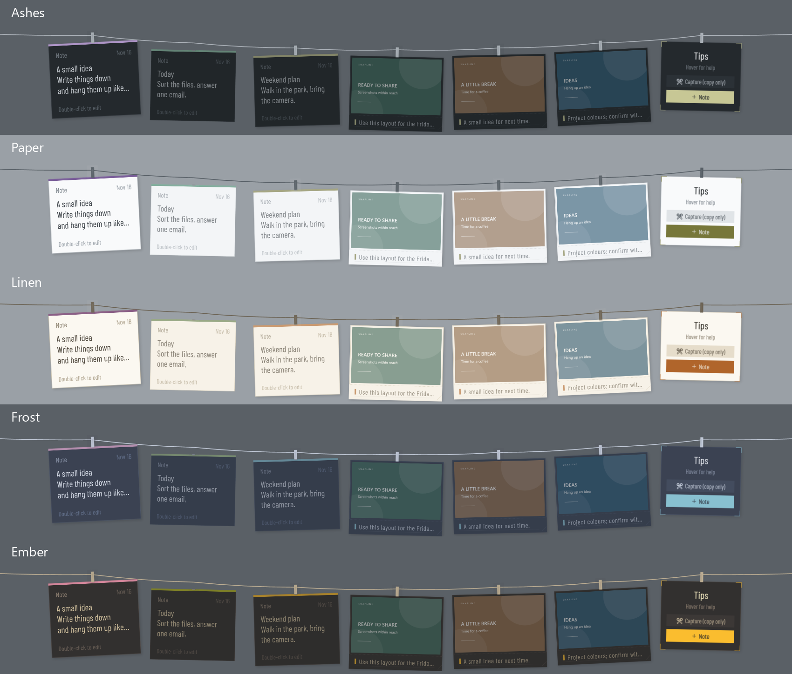

# Snapline for Windows — English, Ashes edition

A clothesline for the things you are working with. Screenshots, notes, files, folders and links hang from a line under the top of the screen; touch the line and they drop into view, ready to copy or drag into another app.

This is an English fork of [TE1233/snapline-windows](https://github.com/TE1233/snapline-windows) (version 0.5.8), restyled in the Base16 Ashes palette and extended. The interaction idea comes from [Tendedero](https://github.com/alejandrobujan/tendedero) for macOS. See [THIRD_PARTY_NOTICES.md](THIRD_PARTY_NOTICES.md).

Everything runs on your PC. The app has no network code, uploads nothing, and does not change Windows screenshot settings.



## What is different from upstream

- English interface.
- Square look in five themes (Ashes by default, two light, two more dark) with the Barlow Condensed font (falls back to Segoe UI if it is not installed).
- The line hangs from a [komorebi-bar](https://github.com/LGUG2Z/komorebi) at the top of the screen when one is running, and its tension is adjustable.
- The line rolls: any number of cards, with the focused card enlarged, driven by wheel, drag or keyboard.
- Reorder by dragging, pull a card off to drop it elsewhere, delete on a peg or a bin, with Undo. "Keep" protects a card from every kind of clearing and gives it a yellow edge.
- Files, folders and web addresses hang as reference cards. The original is never moved, changed or deleted.
- Hang the clipboard with one shortcut; copy a card by its number.
- A note can carry one picture: copy an image, open the note and press `Ctrl+V`. On the line, clicking the picture copies the picture and clicking the rest of the note copies its text; a note with only a picture copies the picture wherever you click. Resting the pointer on the picture previews the picture alone, large; resting it on the rest of the note previews the whole note. Right-click a note with a picture and choose `Open picture` to see it in your image viewer.
- Notes take light formatting. In the editor, `B`, `I` and `U` (`Ctrl+B`, `Ctrl+I`, `Ctrl+U`) mark the selection `**bold**`, `*italic*` or `__underlined__`. `To-do` (`Ctrl+T`) turns lines into `[ ]` boxes and `Tick` (`Ctrl+D`) ticks them; Enter at the end of a to-do starts the next one. The note stays plain text with these marks, and the card on the line draws them. Click a box on the card to tick it without opening the note. Copying a note leaves the bold, italic and underline marks out.
- Optional auto-clear of old cards.
- Start at login is off until you turn it on.
- Animation is your choice (Preferences → Misc). **Basic**, the default, is light: the cards hang still, a removed card goes at once, and the line still opens, glides and answers presses. **Fun** makes the cards hang like clothes on a line: they swing when the line glides, trail and swing when dragged, sway aside when the pointer brushes past, drop onto the line when newly hung, and a gentle gust runs along now and then; removed cards fall. On battery Fun behaves as Basic, unless you turn "Reduce animation on battery" off. Windows' own animation setting is not consulted.
- Light on the PC: while the line is closed Snapline checks the pointer a few times a second (more often near the top of the screen, so opening stays instant), screenshots are reloaded at thumbnail size, and memory is handed back a few seconds after the line closes. In Fun the swing runs only while something moves.
- Calculations in notes: start a note with a line that says `math`, `sum` or `avg`. In a `math` note each line is worked out: `12*(3+4)`, `2^10`, `sqrt(2)`, `15% of 80`, `x = 5` then `x*3`, with `sqrt abs round floor ceil sin cos tan log ln exp min max`, `pi` and `e`. A `sum` or `avg` note adds up or averages the last number on each line (`coffee 4.50`); a line with a number written like `2,50` or a date like `Nov 25` at its end is not counted. Unit conversions work in all three: `5 km in miles`, `72 f to c`, `3 cups in ml`, `1.5 GB in MB`, `90 min in h`, `60 mph in km/h` (length, mass, volume, area, speed, time, data and temperature; no currencies, as Snapline never goes online). Results show at the end of each line on the card and in the editor, with the total underneath; at the end of a line in the editor, type `=` or press `Tab` to write the result in. Copying the note copies the results too. Other notes are never calculated.

## Shortcuts

| Keys | Action |
|---|---|
| `Ctrl+Alt+S` | Open the line and keep it open; again to close |
| `←` `→` | Roll the line (after `Ctrl+Alt+S`) |
| `Enter` | Copy the focused card and close |
| `1`–`9` | Copy the card with that number and close |
| `K` | Keep or stop keeping the focused card |
| `Delete` | Delete the focused card (Undo appears) |
| `Ctrl+Z` | Bring back the card just deleted (after `Ctrl+Alt+S`) |
| `Esc` | Close |
| `Ctrl+Alt+D` | Hang what is on the clipboard |
| `Ctrl+Alt+N` | Start a new note |
| `Ctrl+Alt+A` | Capture a region and hang it (default; change it in the tray menu) |

While the line is open from `Ctrl+Alt+S`, these plain keys go to Snapline rather than the app underneath, until you close the line or click somewhere else. A strip under the line lists them for as long as they do.

`Ctrl+Alt+S`, `Ctrl+Alt+D`, `Ctrl+Alt+N` and the capture shortcut can each be changed to keys of your own, or turned off, in Preferences → Behaviour. Snapline refuses keys that another of its shortcuts already uses, and keeps the old shortcut when Windows reports the new one is taken by another program. The Tips card, the tray and Help show the keys you chose.

## Mouse

- Touch the line at the top centre of the screen to open it. It hides when you leave.
- Click a card to copy it. Double-click to open it (a note opens for editing). A pressed card sinks a little at once, so every click is answered even before the copy shows.
- A note copies a moment after the click, so double-clicking one to paste into it leaves the clipboard alone.
- Scroll, or swipe sideways, to move the line when it holds more cards than fit. It glides: one wheel notch moves it one card, a fast spin carries on in one glide, and a touchpad moves it as far as your fingers go, then settles on a whole card. Cards slide in and fade out at the ends. When every card is in view, scrolling does nothing. In Fun the cards swing as the line glides.
- Hold a screenshot to open it in Paint. After a moment a bar fills along its top with "Keep holding: Edit in Paint"; let go before it fills and nothing happens.
- Drag a card along the line to reorder.
- Pull a card down to take it off the line: drop it into another app, or on the Tips card to delete it.
- Click a peg to delete the card. Undo shows for a few seconds.
- Right-click a card for more, including Keep.
- Drop a file, folder, link or text onto a card to hang it. Images are copied onto the line; other files and folders are hung as references.
- Hover the Tips card for a reminder of all of this.

## Tray menu and Preferences

Capture shortcut, Undo remove (while a removed card can still come back, naming it), theme, font, card size, line tension, touch line length, auto-clear, keep visible, import images, clear screenshots, start at login, Preferences…, help, quit and close menu.

**Preferences…** has every setting in one small window with four tabs, laid out like Pebble's. It has its own header, so tiling window managers leave it floating; drag the header to move it, and Esc or ✕ closes it. Changes apply at once, and every default keeps Snapline's original behaviour:

- **Look:** theme and font (Snapline restarts to apply either), Tips card (Full, or Compact: a slim tab with the same help, ✂ and ＋ buttons, and a full-size bin while you pull a card down), card size.
- **Line:** line tension, touch line length; how soon a card's preview appears (0.1–1.5 s, about 0.3 s at first), how long the line stays open after the pointer leaves it (0.3–5 s, 0.7 s at first), how long Undo shows (3–30 s, 7 s at first).
- **Behaviour:** the shortcuts: capture a region, open the line, hang the clipboard and start a note, each with its original keys, Custom… (press the keys you want) or Off; auto-clear old cards; start at login.
- **Misc:** animation (Basic or Fun) and "Reduce animation on battery" (on at first); how long the pointer rests on the touch line before it opens (0–1 s, at once at first); how many screenshots and reference cards are held (10–200 each, 60 at first). Lowering a limit below what is hung asks first, then takes the oldest cards that are not kept off the line at once; kept cards stay and files behind reference cards are never touched.

The touch line is the thin strip at the top centre that opens the line. It has three lengths: short, medium (one and a half times that), and long, which matches the width of the date and clock in the middle of a komorebi bar.

Theme offers five palettes: Ashes (dark, the default), Paper (light, cool grey), Linen (light, warm), Frost (dark, blue-grey) and Ember (dark, warm). Snapline restarts itself to apply one, which takes about a second. `--theme <name>` starts with a palette without saving the choice.

Font offers Barlow Condensed (the default, used when it is installed) and five fonts that ship with Windows: Segoe UI, Calibri, Trebuchet MS, Georgia and Consolas. Sizes are adjusted to each font. Barlow Condensed has no italic that Windows can draw here, so italic text in notes looks like ordinary text with it; the other fonts show real italics. `--font "<name>"` starts with a font without saving the choice.

Card size makes everything on the line larger: Small (the original size), Medium (a quarter larger) and Large (half as large again). Notes, screenshots with their caption strip, file, folder and link cards, and the Tips card all grow, with their text. A note's preview and the note editor grow too. Larger cards hang in wider slots, so fewer fit across the screen, and the open line reaches further down. The choice applies at once, without a restart, and is remembered.

## Limits and data

- Up to 60 screenshots and 60 reference cards are held (change both in Preferences → Misc); when a limit is passed, the oldest card that is not kept makes room.
- Only captures made with Snapline's own capture shortcut are collected. `Win+Shift+S` and other screenshot tools are not.
- Data lives in `%LOCALAPPDATA%\Snapline`. `--data-dir <folder>` uses another folder.

## Build

Requires Windows with .NET Framework 4.8, which Windows 10 and 11 include. No SDK or packages are needed; the script uses the compiler that ships with the framework, so the source is limited to C# 5.

```powershell
powershell -NoProfile -ExecutionPolicy Bypass -File .\build.ps1
```

The result is `dist\Snapline.exe`. `--self-test` runs the built-in checks; `--memo-test`, `--hover-test`, `--preferences-test` and the other `--*-test` flags run more. Give each one an empty folder with `--data-dir`, as they write there.

## Source layout

| File | Contents |
|---|---|
| `src\Theme.cs` | Colours, font, menu styles, calm mode |
| `src\Store.cs`, `Memo.cs`, `NoteMarkup.cs`, `Links.cs` | Saved data: screenshots, notes, reference cards |
| `src\Shelf*.cs` | The line window: layout, gestures, motion, capture, tray |
| `src\Preferences.cs` | The Preferences window |
| `src\Remark.cs`, `ShortcutEditor.cs`, `RegionCapture.cs` | Caption editor, shortcut dialog, capture overlay |
| `src\*Tests.cs`, `Integration.cs` | Built-in self-tests |

## License

MIT, see [LICENSE.txt](LICENSE.txt).
